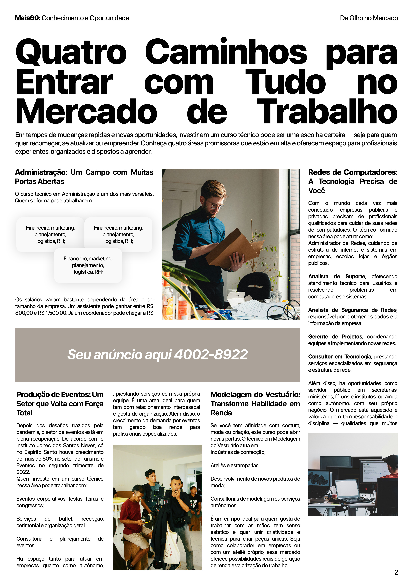
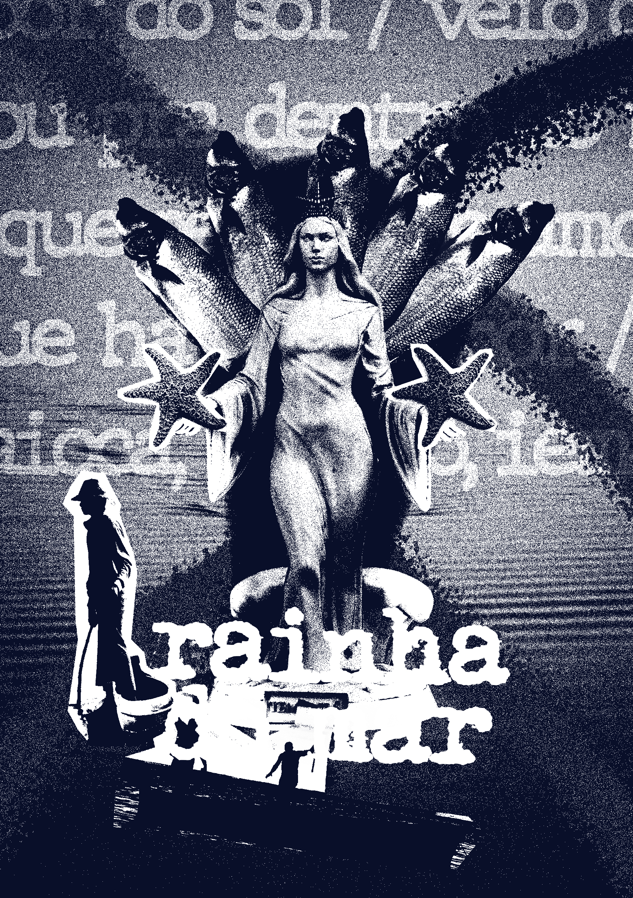
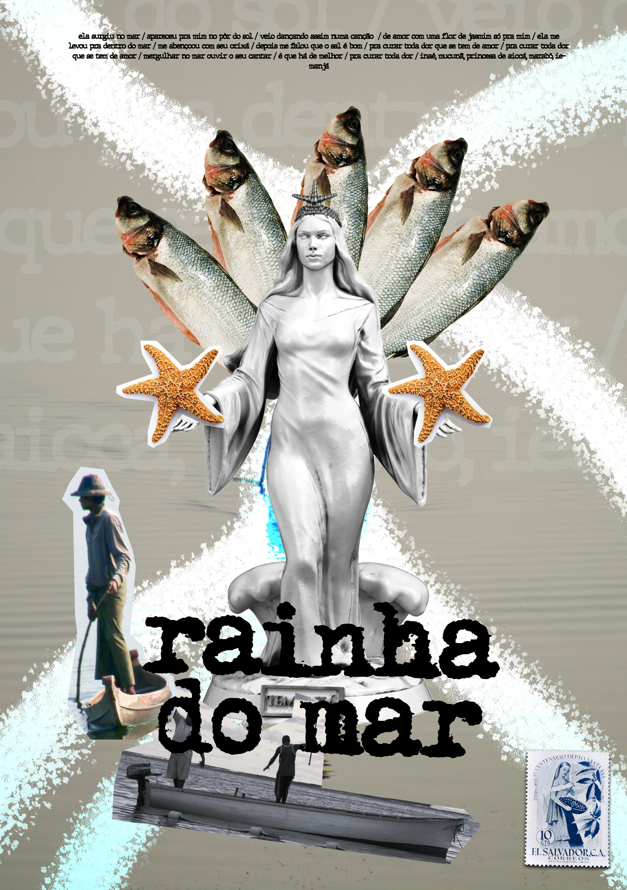
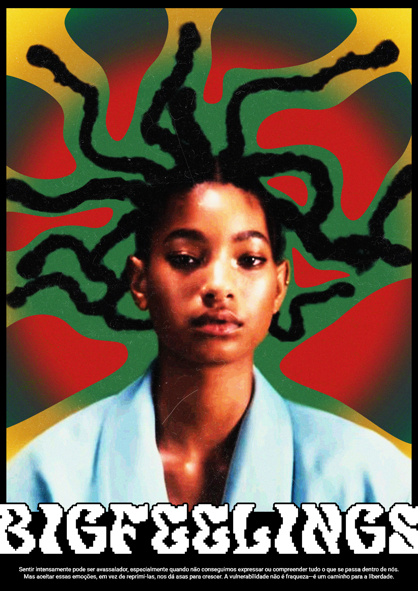

<!DOCTYPE html>
<html lang="pt-BR">
<head>
  <meta charset="UTF-8">
  <meta name="viewport" content="width=device-width, initial-scale=1.0">
  <title>Meu Portfólio</title>
  <link rel="stylesheet" href="style.css">
  
</head>
<body>
  <header>
    

      <h1>Kayke Marcos</h1>
      
Designer gráfico

    

  </header>

  <main class="container">
    <section class="card">
      <h2>Sobre mim</h2>
      
Nasci em Vila Velha e, desde cedo, me interesso por arte. Sempre fui apaixonado pelo ato de criar e não me imagino seguindo outro caminho. Atualmente, trabalho com fotografia e design gráfico, e estou cursando técnico em Multimídia no @ceetvasco. Antes disso, concluí o curso técnico em Produção de Moda.
       
      Me considero um profissional versátil, tanto na fotografia quanto no design gráfico. No meu trabalho com fotografia, transito entre ensaios para marcas e projetos autorais mais experimentais. No design, tenho experiência na criação de identidades visuais, cartazes e materiais publicitários, adaptando meu estilo tanto para propostas mais corporativas quanto para abordagens mais criativas.

    </section>

    <section class="card">
      <h2>Habilidades</h2>
      <ul>
        <li>Adobe Creative Suite</li>
        <li>Trabalho artístico</li>
        <li>Criatividade</li>
        <li>Adobe InDesign</li>
        <li>Fotografia</li>
        <li>Edição de imagens</li>
      </ul>
    </section>

    <section class="card">
      <h2>Projetos</h2>
      
      <article class="projeto">
        <h3>Diagramação para página de revista</h3>
        

          
        

        
Diagramação editorial para matéria de revista, com foco em hierarquia tipográfica, organização de conteúdo e legibilidade. O projeto combina uma abordagem visual contemporânea com estrutura informativa clara, destacando diferentes áreas profissionais por meio de textos, imagens e elementos gráficos.

      </article>

      <article class="projeto">
        <h3>Design de pôster autoral</h3>
        

          
          
        

        
Pôster autoral em técnica de colagem digital inspirado no universo marítimo e nas tradições populares brasileiras. A composição reúne elementos simbólicos do mar, fotografia e tipografia experimental para construir uma narrativa visual que explora identidade, memória e espiritualidade.

      </article>

      <article class="projeto">
        <h3>Design de pôster autoral</h3>
        

          
        

        
Pôster experimental que investiga a representação visual das emoções intensas por meio da combinação de fotografia, formas abstratas e tipografia expressiva. O projeto busca traduzir sentimentos complexos em uma linguagem gráfica vibrante, explorando contraste, textura e composição contemporânea.

      </article>
    </section>
  </main>

  <footer>
    

      
E-mail: kaykemarcos.ks@gmail.com

      
LinkedIn: www.linkedin.com/in/kayke-marcos-776439273

    

  </footer>

  

    &times;
    
  

  
</body>
</html>
